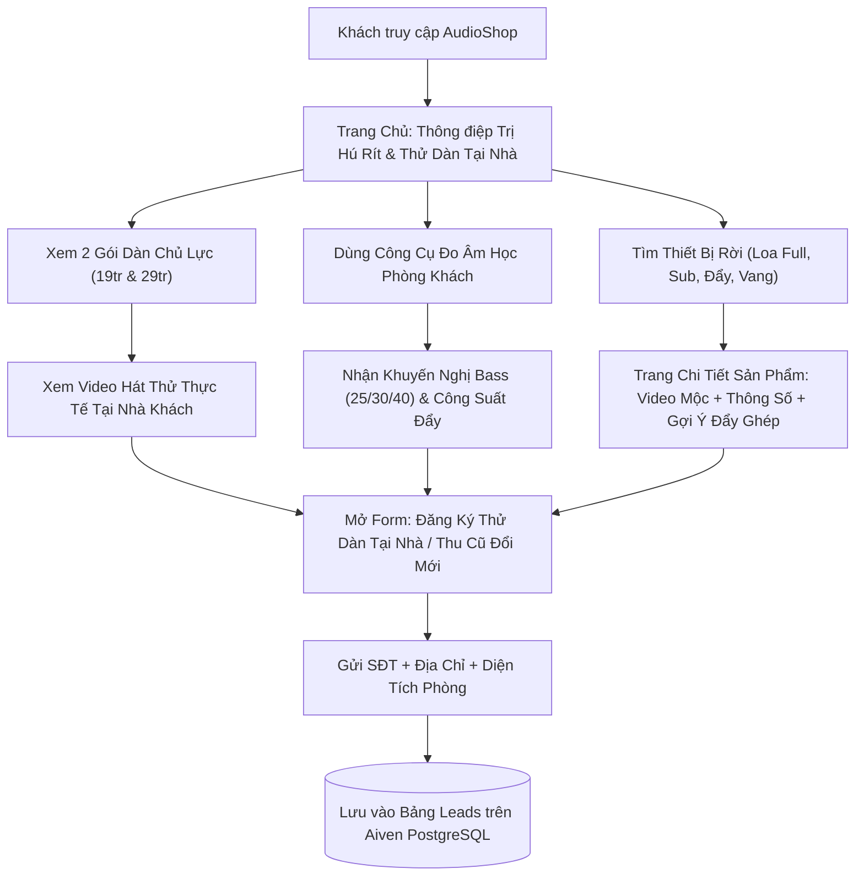
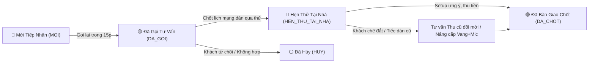

# TÀI LIỆU PHÂN TÍCH NGHIỆP VỤ & ĐẶC TẢ CHỨC NĂNG HỆ THỐNG AUDIOSHOP (TÚ AUDIO)

> **Phiên bản:** 1.0 (Đồng bộ hệ thống Full-stack Vue 3 + Express.js + Aiven PostgreSQL)  
> **Đối tượng sử dụng:** Ban quản trị Tú Audio (Kỹ sư Phùng Văn Tú), Đội ngũ Tư vấn/Kỹ thuật lắp đặt, Đội ngũ Phát triển phần mềm.

---

## 1. Bối Cảnh Kinh Doanh & Mục Tiêu Nghiệp Vụ (Business Context)

### 1.1. Định vị mô hình kinh doanh
- **Thương hiệu:** Tú Audio — Chuyên gia âm thanh karaoke gia đình.
- **Mô hình:** B2C (Bán trực tiếp cho người dùng cuối là gia đình và cá nhân đam mê ca hát/nghe nhạc).
- **Phạm vi phục vụ lắp đặt trực tiếp:** Bán kính **~300km** quanh trụ sở tại Phố Nguyễn Danh Phương, Phường Vĩnh Yên, Tỉnh Phú Thọ (bao phủ Hà Nội và hầu hết khu vực miền Bắc).
- **Nhận diện thương hiệu:**
  - Vàng Gold/Cam (`#FCB728`): Màu chủ đạo tạo điểm nhấn ưu đãi, nút kêu gọi hành động (CTA).
  - Xanh Electric Blue (`#2837FC`): Điểm nhấn công nghệ, nút tư vấn kỹ thuật.
  - Tím than/Nền tối showroom (`#0d0f18`, `#181c2d`): Tạo cảm giác sang trọng, chuyên nghiệp cho thiết bị âm thanh.

### 1.2. Chân dung & Nỗi đau khách hàng mục tiêu
- **Đối tượng chính:** Nam giới độ tuổi **30–60**, yêu thích karaoke và nghe nhạc, chia làm 2 nhóm:
  1. *Nhóm chưa có dàn:* Sợ mua hớ, sợ hàng giả/nhái, không biết phối ghép công suất nên ngại xuống tiền.
  2. *Nhóm đã có dàn nhưng chưa ưng:* Bị hú rít, tiếng mic nặng hát hụt hơi, nghe ở cửa hàng hay nhưng mang về phòng khách nhà mình lại dở hoặc bass bị ù rền.

### 1.3. Chiến lược Phễu Bán Hàng 3 Bước (3-Step Sales Funnel)
Mọi màn hình, nút bấm và quy trình xử lý đơn hàng trên website đều xoay quanh 3 bước chốt sale:
1. **Bước 1 — Core Offer (Mục tiêu số 1):** Chốt bán **2 Gói Dàn Karaoke Trọn Bộ** (Gói 29,9 triệu và Gói 19,8 triệu).
2. **Bước 2 — Downsell 1 (Thu cũ đổi mới):** Nếu khách chê đắt hoặc tiếc dàn cũ, đề xuất thu lại dàn cũ trừ tiền trực tiếp vào hóa đơn lên đời 1 trong 2 gói dàn trên.
3. **Bước 3 — Downsell 2 (Nâng cấp linh kiện lẻ):** Nếu khách chưa đủ tài chính đổi cả bộ, hạ xuống bán lẻ **Vang số K9 + Micro không dây CM 05** (trị hú rít và giúp hát nhẹ ngay trên loa cũ), hoặc bán lẻ Loa Sub, Cục đẩy, Loa Full.

---

## 2. Sơ Đồ Luồng Nghiệp Vụ Tổng Thể (End-to-End Workflows)

### 2.1. Luồng Trải Nghiệm & Chuyển Đổi Khách Hàng (Customer Flow)

### 2.2. Luồng Tiếp Nhận & Xử Lý Đơn Hàng Của Admin (Operations Flow)

---

## 3. Phân Tích Chức Năng Chi Tiết — Phân Hệ Khách Hàng (Client Portal)

### 3.1. Khối Định Vị & Trang Chủ (`HomeView.vue`, `HomeHero.vue`)
- **Mục tiêu nghiệp vụ:** Giải tỏa nghi ngờ trong 5 giây đầu tiên bằng thông điệp giải quyết đúng nỗi đau (*"Hát Nhẹ - Sạch Tiếng - Tuyệt Đối Không Hú Rít"*).
- **Thành phần chức năng:**
  - Thanh thông báo cam kết lắp đặt & cân chỉnh tận nhà bán kính 300km, hiển thị Hotline kỹ thuật trực tiếp.
  - Khối Hero giới thiệu nhanh Gói 29 triệu và 3 chỉ số thực chứng (`300km`, `100% trị hú rít`, `24 tháng bảo hành`).
  - Khối "Tại sao 90% khách hàng tìm đến Tú Audio": Phân tích 3 nỗi đau phổ biến (Sợ hú rít/mic nặng, Sợ phối ghép sai gây cháy treble, Sợ nghe ở shop hay về nhà dở).

### 3.2. Trưng Bày 2 Gói Dàn Trọn Bộ Át Chủ Bài (`ComboOffers.vue`)
- **Mục tiêu nghiệp vụ:** Neo giá trị (Price Anchoring) và thúc đẩy khách chốt nhanh trong ngày tư vấn (Fast-Action Bonus).
- **Nghiệp vụ hiển thị cho 2 gói:**
  1. **Gói Dàn Karaoke 29 Triệu (Phòng 25–45m²):**
     - Giá niêm yết thiết bị: 34.800.000 đ (tổng giá trị thật gồm quà: 40.000.000 đ).
     - Giá bán chuẩn: **29.900.000 đ** (Tiết kiệm thật: 10.100.000 đ).
     - Ưu đãi chuyển khoản trong ngày tư vấn (giữ chỗ 20 ca lắp/tháng): Còn **28.900.000 đ**.
  2. **Gói Dàn Karaoke 19 Triệu (Phòng 15–30m²):**
     - Giá niêm yết thiết bị: 26.700.000 đ (tổng giá trị thật gồm quà: 30.400.000 đ).
     - Giá bán chuẩn: **19.800.000 đ** (Tiết kiệm thật: 10.600.000 đ).
     - Ưu đãi chuyển khoản trong ngày: Còn **18.800.000 đ**.
- **Chức năng tích hợp trên từng thẻ gói:**
  - Nhúng trực tiếp **Video Test Thật** (YouTube 16:9) quay cảnh hát thử thực tế.
  - Liệt kê minh bạch từng thiết bị cấu thành kèm vai trò âm học và danh sách quà tặng thật (dây quang AudioQuest, dây loa đồng, pin sạc, công căn chỉnh).

### 3.3. Công Cụ Dự Toán Âm Học Theo Không Gian Phòng (`RoomCalculator.vue`)
- **Mục tiêu nghiệp vụ:** Giáo dục khách hàng và đóng vai trò nhân viên tư vấn kỹ thuật tự động 24/7.
- **Logic nghiệp vụ đầu vào $\rightarrow$ đầu ra:**
  - *Đầu vào:*
    1. Diện tích phòng (`Dưới 20m²`, `20 - 35m²`, `35 - 55m²`).
    2. Đặc điểm kết cấu (`Phòng kín` hoặc `Thông phòng ăn / Cầu thang hở`).
  - *Đầu ra khuyến nghị:*
    - Phòng `< 20m²`: Khuyên dùng Bass 25cm (hoặc Bass 30cm vừa), đẩy 600W/kênh, Sub điện 30cm (tránh dồn áp lực gây tức ngực) $\rightarrow$ Gợi ý **Gói 19 triệu**.
    - Phòng `20 - 35m²` + Cầu thang hở: Bắt buộc Bass 30cm Coil 75 (phóng xa bù không gian hở), đẩy 4 kênh x800W, Sub hơi 40cm $\rightarrow$ Gợi ý **Gói 29 triệu**.
    - Phòng `35 - 55m²`: Khuyên dùng 2 đôi Full 30 hoặc Bass 40cm, đẩy $\ge$ 1000W/kênh, Sub hơi 50cm $\rightarrow$ Gợi ý cấu hình thiết kế riêng.
  - Nút **"Tư Vấn Đúng Cấu Hình Này Cho Tôi"** tự động điền thông số phòng khách vào form đăng ký Lead.

### 3.4. Kho Thiết Bị, Tìm Kiếm & Bộ Lọc Chuyên Sâu (`ProductListView.vue`)
- **Chức năng lọc đa chiều:**
  - Lọc theo 6 danh mục: `Loa Full`, `Loa Sub`, `Dàn Karaoke Trọn Bộ`, `Loa Di Động`, `Cục Đẩy`, `Vang Số & Micro`. (Khi chọn tab *Dàn Karaoke Trọn Bộ*, hệ thống tự hiển thị 2 gói dàn chủ lực thay vì danh sách trống).
  - Lọc theo đường kính Bass: `25 cm`, `30 cm`, `40 cm`.
  - Tìm kiếm theo tên model hoặc mô tả chất âm từ thanh tìm kiếm trên Header.
  - Sắp xếp theo giá tăng dần / giảm dần.

### 3.5. Trang Chi Tiết Thiết Bị & Thực Chứng Âm Thanh (`ProductDetailView.vue`)
- **Mục tiêu nghiệp vụ:** Thuyết phục khách hàng bằng thông số minh bạch và video nghe thử mộc.
- **Chức năng chi tiết:**
  - Chuyển đổi linh hoạt giữa Tab `🖼️ Hình Ảnh Thiết Bị` và `🎬 Video Mô Tả & Test Âm`, kèm nút phát nhanh ngay trên ảnh.
  - Khối **Video Mô Tả Toàn Diện:** Phát video 16:9 kèm 4 điểm kiểm định chất âm (Dải Treble kèn, Dải Trung Vocal, Chống hú sát loa, Dải Bass).
  - Khối **Kỹ Thuật Phối Ghép Chuẩn:** Chỉ rõ công suất cục đẩy tương thích (ví dụ: Loa Full 30 PF 12 cần đẩy 600W–800W/kênh ở 8 Ohms) để tránh tình trạng khách tự ghép đẩy yếu gây méo tiếng, cháy loa.
  - Bảng **Thông Số Kỹ Thuật** & Danh sách **Quà Tặng Độc Quyền**.

### 3.6. Phễu Đăng Ký Tư Vấn & Thu Cũ Đổi Mới (`QuickOrderModal.vue`)
- **Mục tiêu nghiệp vụ:** Thu thập thông tin khách hàng ít ma sát nhất (không bắt đăng ký tài khoản rườm rà, không ép thanh toán thẻ trước).
- **Nghiệp vụ xử lý:** Thu thập `Họ tên`, `SĐT/Zalo`, `Địa chỉ lắp đặt`, `Ghi chú nhu cầu/đặc thù phòng` và tên thiết bị đang xem, gửi qua API `POST /api/v1/leads` lưu thẳng lên Aiven PostgreSQL.

---

## 4. Phân Tích Chức Năng Chi Tiết — Phân Hệ Quản Trị (Admin Portal)

### 4.1. Đăng Nhập & Phân Quyền Bảo Mật (`AdminLoginView.vue`, `authStore.js`)
- **Nghiệp vụ bảo mật:**
  - Toàn bộ đường dẫn `/admin/*` (trừ `/admin/login`) được bảo vệ bởi Navigation Guard (`router.beforeEach`). Chưa đăng nhập sẽ bị đẩy về trang Login.
  - API đăng nhập (`POST /api/v1/admin/auth/login`) truy vấn bảng `admins` trên Aiven PostgreSQL, đối chiếu mật khẩu băm `bcryptjs` và cấp `JWT Token` (thời hạn 7 ngày).
  - Mọi API quản trị đều yêu cầu header `Authorization: Bearer <token>`.

### 4.2. Bảng Điều Khiển Tổng Quan (`AdminDashboardView.vue`)
- **4 Chỉ số đo lường cốt lõi (KPIs):**
  1. **Doanh Số Đã Chốt Đơn:** Tổng `deal_value` của các đơn có trạng thái `DA_CHOT`.
  2. **Lịch Hẹn Thử Dàn Tại Nhà:** Tổng số ca `HEN_THU_TAI_NHA` đang chờ kỹ thuật viên chở loa đi test.
  3. **Khách Mới Chờ Gọi Lại:** Số đơn trạng thái `MOI` cần xử lý ngay trong 15 phút (kèm cảnh báo đỏ trên Topbar & Sidebar).
  4. **Thiết Bị Trong Kho:** Tổng số model sản phẩm hiện hành trên Database.
- **Giám sát kết nối:** Huy hiệu trạng thái trên Topbar hiển thị `🟢 Aiven PostgreSQL Live` (khi kết nối Cloud thành công) hoặc `🟡 Chế Độ Cache Nội Bộ`.

### 4.3. Quản Lý Khách Hàng & Lịch Hẹn Thử Dàn (`AdminLeadsView.vue`)
- **Quy trình quản lý 5 trạng thái:** `Mới Tiếp Nhận` $\rightarrow$ `Đã Gọi Điện` $\rightarrow$ `Lên Lịch Thử Dàn` $\rightarrow$ `Đã Bàn Giao Chốt` / `Đã Hủy`.
- **Tác nghiệp nhanh cho Sales & Kỹ thuật:**
  - Bấm SĐT để gọi trực tiếp trên điện thoại; bấm nút `💬 Zalo` để mở thẳng cửa sổ chat `zalo.me/{sdt}` gửi ảnh/video cấu hình.
  - Modal chi tiết cho phép cập nhật **Ngày & Giờ hẹn mang dàn qua nhà thử**, **Giá trị đơn chốt (VNĐ)**, **Đặc điểm âm học phòng khách** và **Ghi chú kỹ thuật** (ví dụ: mang kèm sub hơi 40 qua thử thêm).

### 4.4. Quản Lý Kho Loa & Thiết Bị (`AdminProductsView.vue`)
- **Modal Thêm / Sửa thiết kế 2 bên (2 cột):**
  - *Cột trái:* Tên thiết bị, Danh mục (`loa-full`, `loa-sub`, `cuc-day`, `vang-so-micro`, `loa-di-dong`), Giá bán, Giá niêm yết, Huy hiệu, Đường kính Bass, Công suất RMS, Diện tích phòng, Cục đẩy phối ghép, Mô tả chất âm.
  - *Cột phải:* Link ảnh đại diện + Ảnh xem trước, **Link Video Mô Tả YouTube/MP4** + Tiêu đề video + **Trình xem trước Video trực tiếp (Live Preview)** để kiểm định video trước khi lưu.
- Bảng danh sách hiển thị trạng thái `▶️ Có Video` / `Chưa có` giúp quản trị viên rà soát thiết bị nào chưa quay video test.

### 4.5. Cấu Hình 2 Gói Dàn Chủ Lực (`AdminCombosView.vue`)
- Cho phép chỉnh sửa trực tiếp Giá bán, Giá chuyển khoản trong ngày, Giá gốc niêm yết, Link Video và Tiêu đề Video test thực tế cho cả **Gói 29 Triệu** và **Gói 19 Triệu**.
- Hệ thống tự động tính toán lại số tiền khách tiết kiệm (`saved_amount = list_price - price`) và đồng bộ ngay lên trang chủ.

---

## 5. Kiến Trúc Dữ Liệu & API Đồng Bộ Cloud

Hệ thống sử dụng cơ sở dữ liệu quan hệ **PostgreSQL** trên cụm đám mây **Aiven Cloud** (kết nối SSL) với 8 bảng chính:
- `admins`: Tài khoản quản trị và mật khẩu mã hóa bcrypt.
- `categories`: 6 danh mục thiết bị đồng bộ khóa ngoại với bảng sản phẩm.
- `products`: Lưu trữ thông số vật lý, giá, video test âm, cục đẩy phối ghép, thông số `specs` (JSON) và quà tặng `gifts` (JSON).
- `combos`, `combo_components`, `combo_gifts`: Quản lý 2 gói dàn chủ lực và thành phần linh kiện chi tiết.
- `leads`: Toàn bộ dữ liệu khách hàng đăng ký tư vấn/thử dàn tại nhà.
- `trade_ins`: Cấu trúc bảng lưu trữ yêu cầu thu cũ đổi mới.

---

## 6. Đánh Giá Hiện Trạng & Lộ Trình Phát Triển Tiếp Theo

| Nhóm Chức Năng | Trạng Thái Hiện Tại | Ghi Chú Kỹ Thuật / Hướng Mở Rộng |
| :--- | :--- | :--- |
| Giao diện Client (Trang chủ, Danh mục, Chi tiết, Đo phòng) | **Đã hoàn thiện & Chạy Live DB** | Lấy dữ liệu trực tiếp từ Aiven PostgreSQL, có fallback cache |
| Hệ thống Video Mô Tả (Admin nhập/preview & Client xem) | **Đã hoàn thiện 2 bên** | Cần thay link YouTube mẫu bằng video quay thực tế của Tú Audio |
| Admin Dashboard, Leads CRM, Login JWT + Bcrypt | **Đã hoàn thiện & Chạy Live DB** | Đã kiểm chứng API đọc/ghi, xác thực mật khẩu băm trên PostgreSQL |
| Quản lý Sản phẩm & Gói Dàn trong Admin | **Đã hoàn thiện cơ bản** | Cần bổ sung thêm ô nhập sửa từng dòng `specs` & `gifts` trên Modal Admin |
| Số Hotline, Ảnh chụp thực tế thiết bị | **Đang dùng dữ liệu mẫu** | Cần cập nhật SĐT thật của anh Tú và ảnh chụp thật thiết bị PF/CM |
| Phễu tặng Ebook PDF miễn phí (Lead Magnet toàn quốc) | **Chưa triển khai giao diện** | Cần bổ sung form nhận Ebook "Bí mật âm thanh karaoke" ở trang chủ |
| Quy trình Thu cũ đổi mới có tải ảnh (Bảng `trade_ins`) | **Mới có bảng DB** | Hiện đang dùng chung form Lead; cần bổ sung API upload ảnh & tab định giá Admin |
| Giỏ hàng mua lẻ phụ kiện (`CartDrawer` / `Checkout`) | **Mới có khung `cartStore`** | Cần bổ sung giao diện giỏ hàng cho khách đặt mua lẻ micro, vang số, dây jack |
